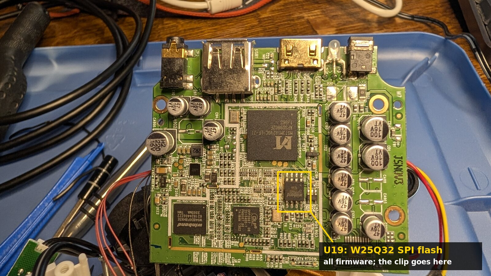
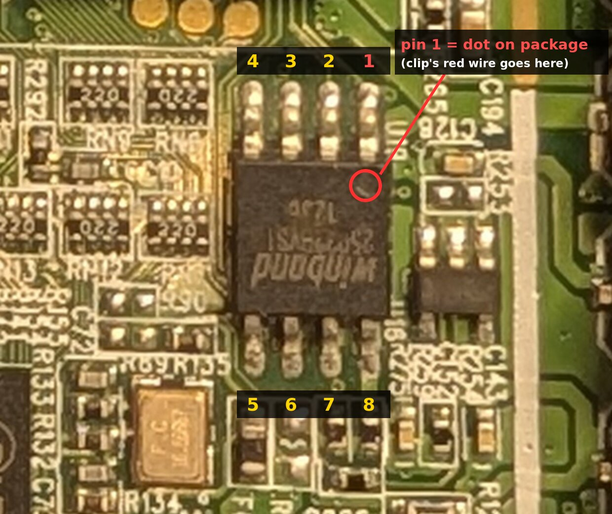
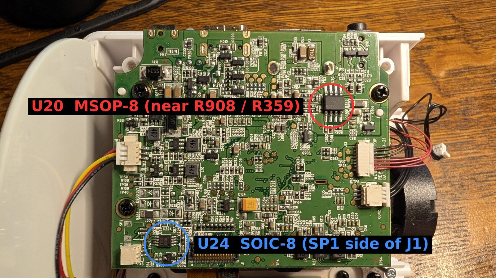

# 01 Hardware

The firmware lives in the 8-pin Winbond chip marked above (U19), on the same
side of the board as the MStar SoC. This is the chip the clip goes on.

Pin 1 is at the small dot moulded into the package. In the orientation of
these photos (connectors at the top, chip lettering upside down) that is the
top-right leg; pins 1 to 4 run right to left along the top edge, pins 5 to 8
left to right along the bottom edge. Check the dot on your own board rather
than trusting the photo.

## Main parts

| Part | Marking | Role |
|---|---|---|
| SoC | MStar **MST3M182VGC-LF-Z1** (BGA) | Scaler/media SoC: HDMI in, USB media player, OSD, IR. CPU core is MStar **AEON R2** (OpenRISC-derived, variable-length instructions) with an 8051 "PM" micro for standby |
| SPI flash | Winbond **25Q32BVSIG** (W25Q32BV), SOIC-8 208 mil, 3.3 V, 4 MB. Designator **U19** | All firmware and all saved settings |
| DRAM | Winbond W948D6FBHX5E | 64 MB |
| DLP controller | TI **DPP2607** | Drives the DMD; the SoC configures it over I2C at address 0x36 (8-bit) |
| Headphone driver | Anpec **APA2308**, MSOP-8, designator U20 | Class-AB stereo |
| Speaker amplifier | SOIC-8 marked "4103S", designator U24 | Feeds the speaker connector SP1 |
| IR receiver | Separate board "WE182S_IR_BOARD REV V1.0", 3-pin (VCC, GND, DATA) | NEC-coded remote |

There is **no separate EEPROM**. Volume, picture settings and the last source
are stored in the SPI flash.

The other side of the board carries the two audio ICs (not involved in flashing):

## Things worth knowing before you open it

- The flash's write-protect pin (pin 3, /WP) is pulled low on the board through
  roughly 10 kΩ. Reading works without touching it. Writing does not: see
  [04](04-flashing-with-a-raspberry-pi.md).
- With the globe unplugged, the clip's 3.3 V powers part of the board. On the
  unit tested, the SoC did not disturb the SPI bus in that state.
- The unit has no HDMI-CEC behaviour that helps here; the firmware contains CEC
  code but power-on by CEC was not observed.
- The remote sends NEC extended codes, address 0x6380. The full table is in
  [05](05-hidden-menus-and-ir-codes.md).

## Observed stock behaviour

- DC applied: red LED, standby. Remote Power: green LED, source page with the
  USB icon highlighted. Right selects HDMI, OK makes it live.
- It always starts on the USB source page, whatever was selected before, with
  or without an HDMI signal or a USB stick. There is no USB autoplay.
- The settings menu offers colour temperature, OSD language and an off-timer.
- Volume (0 to 20) is remembered across power cycles.
