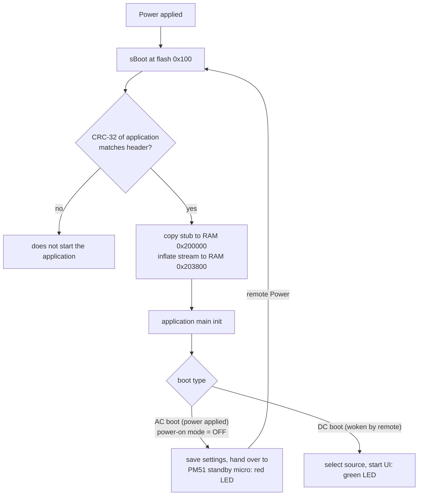

# 02 Firmware layout

Everything below was read from one unit's 4 MB flash dump (firmware build
"Nov 18 2013, 11:47:24"). Offsets are flash offsets unless marked RAM.

## Flash map

| Flash offset | Size | Contents |
|---|---|---|
| 0x000000–0x01ffff | 128 KB | **sBoot** bootloader, two 64 KB banks, uncompressed AEON R2 code. Tags `MSVC0000S3` and `SBT_...` at the end of each bank. Contains a zlib inflate |
| 0x020000–0x02007f | 128 B | **Application header** (see below) |
| 0x020080–0x02387f | 0x3800 | Application **stub**, uncompressed, copied to RAM 0x200000 |
| 0x023880–0x0d5f02 | 730,755 B | **Main application**, raw deflate stream, inflates to 1,646,704 bytes at RAM 0x203800 |
| 0x0d5f03–0x0d5f08 | 6 B | Trailer: u32 inflated length, then 2 bytes sBoot does not read |
| 0x0d5f09–0x16252c | ~575 KB | Data used by the application (tables; not analysed in detail) |
| 0x16252d–0x172431 | | Raw deflate stream → 65,280 bytes, starts with an 8051 `LJMP`: most likely the **PM51 standby micro** firmware |
| 0x178c9f–0x188caa | | Raw deflate stream → 65,540 bytes (not analysed) |
| 0x1940c0–0x235bf0 | | Raw deflate stream → 1,464,896 bytes: a **second AEON program** (base 0; contains video-player mailbox strings, so probably the media decoder image) |
| 0x2779e8–0x358dba | 922,578 B | **Start-up video**: a complete AVI (640×480 H.264 + MP3, 7.9 s) |
| 0x358dbb–0x39ffff | ~290 KB | Unidentified data, then erased space |
| 0x3a0000–0x3bffff | 128 KB | Erased (all 0xFF). Used here as a scratch area to test writing |
| 0x3c0000–0x3dffff | 128 KB | **User settings**, two mirrored rings (see below) |
| 0x3e0000–0x3fffff | 128 KB | Two alternating 5,331-byte blocks written at remote power-off (database-style data; neither source nor volume) |

`binwalk` signatures on this image are all false positives. The compressed
streams have no zlib or gzip header: they are raw deflate (`wbits = -15`).

## Boot chain



The standby micro wakes the SoC on the remote's Power key; the SoC then boots
again from sBoot with the "DC boot" flag set.

## Application header and integrity check

Header at 0x20000, little-endian words:

| Offset | Value (stock) | Meaning |
|---|---|---|
| 0x20000 | 0x00020080 | Flash offset where the image starts |
| 0x20004 | 0x00200000 | RAM load address of the stub |
| 0x20008 | 0x002b5e89 | RAM end = load address + image length |
| 0x2000c | 0x000d5f09 | Flash offset where the image ends |
| 0x20010 | 0 | |
| 0x20014 | 0x3fe64d1d | **CRC** |

sBoot programs the SoC's CRC engine with polynomial 0x04C11DB7 and checks the
image before inflating it. The check is:

> **CRC-32/MPEG-2 with initial value 0 and no final XOR, over flash
> [0x20080, 0xd5f09), must equal the word at 0x20014.**

Also checked: the stub contains the bytes `BE AD DE` at stub offset 0x1147 and
the image length (0x000b5e89) at stub offset 0x114a; the word 0x55aa5678 sits
at flash 0x21180 (the USB updater uses it to recognise the software).

Consequences for patching:

- The application is compressed, so a patch means inflate, change, deflate
  again, recompute the CRC.
- The space for the stream is fixed, because other data follows it. zlib at
  level 9 produces a stream about 600 bytes too large. **7-Zip's deflate
  encoder** produces one about 21 KB smaller, which fits.
- A shorter stream is padded with zeros up to the trailer. Inflate stops at
  the end of the last block, so the padding is ignored, and no length field
  needs to change. Confirmed on hardware.

`tools/fwimage.py` implements all of this and re-checks its own output.

## Memory map of the application (RAM)

| RAM | Contents |
|---|---|
| 0x200000–0x2037ff | Stub from flash 0x20080 |
| 0x203800–0x3958ef | Inflated application (code, then strings and data) |
| 0x3b540c | Start of the saved-settings structure in RAM |
| 0x3956fc | Settings-store descriptor |

To analyse it, build one image and load it at 0x200000:

```
python -m tools.fwimage unpack dumps/pristine_1.bin build/mapp_full.bin
```

**Pitfall:** loading only the inflated stream at 0x200000 gives a disassembly
that looks fine (branches are relative) but every string and data reference is
off by 0x3800. If printed messages make no sense where they are used, this is
why.

## Reverse-engineering setup

- Ghidra 12.1 with the AEON R2 processor module
  [eb4x/ghidra-plugin-aeon](https://github.com/eb4x/ghidra-plugin-aeon)
  (language `AEON:LE:32:R2`; instructions are stored big-endian, data
  little-endian).
- Import `build/mapp_full.bin` as a raw binary at base 0x200000 and run
  auto-analysis: about 4,800 functions.
- The code base is MStar's "Chakra" TV application (`tv-ap/dvb/ui2_M10/...`,
  `CUS04_ATV_MM_M10`). Debug strings are plentiful and are the fastest way in.
  The print routine is at RAM 0x2eb318 (one argument) and 0x2eb2aa (printf style).
- Useful idiom: constants and addresses are built with `b.movhi rX,hi`
  followed by `b.addi rY,rX,lo`; small constants use the two-byte
  `b.movi rD,imm` (`98 E0|imm` for r7).
- `ghidra_scripts/` holds the headless scripts used: decompile a list of
  functions, list cross-references, list instructions with bytes, list call
  sites with their first argument.

## Settings store

User settings live in two mirrored rings at 0x3c0000 and 0x3d0000:

- Each ring is 64 KB of 4 KB sectors. One 1,280-byte record is written per
  sector, to the next free sector, **on every power cycle**. A bitmap in the
  ring's first sector marks used sectors.
- A record is a header (magic `a5 a5 5a 5a ...`) up to offset 0x1b0, then
  0x34c bytes of settings data starting at record offset 0x1b1. In RAM that
  data starts at 0x3b540c.

Fields identified (record offset → RAM):

| Record offset | RAM | Meaning |
|---|---|---|
| 0x1b5 | 0x3b5410 | Source as shown in the menu (1 HDMI, 3 USB) |
| 0x1b9 | 0x3b5414 | **Current input source** (4 HDMI, 6 USB 1, 7 USB 2) |
| 0x1bd | 0x3b5418 | Previous source |
| 0x2e6 | | Volume in percent (menu step × 5) |
| 0x4c5 | 0x3b5720 | Power-on mode (0 last state, 1 off, 2 on) |
| 0x4c1 | 0x3b571c | "Was in standby" flag |

The saved source and the saved power-on mode are both **overwritten with
constants during start-up** (see [03](03-patches.md)), which is why editing the
settings in flash cannot change the start-up behaviour.

The flash chip's block-protect bits are managed by the firmware: it protects
the whole chip in normal operation and lifts protection itself around its own
writes.
