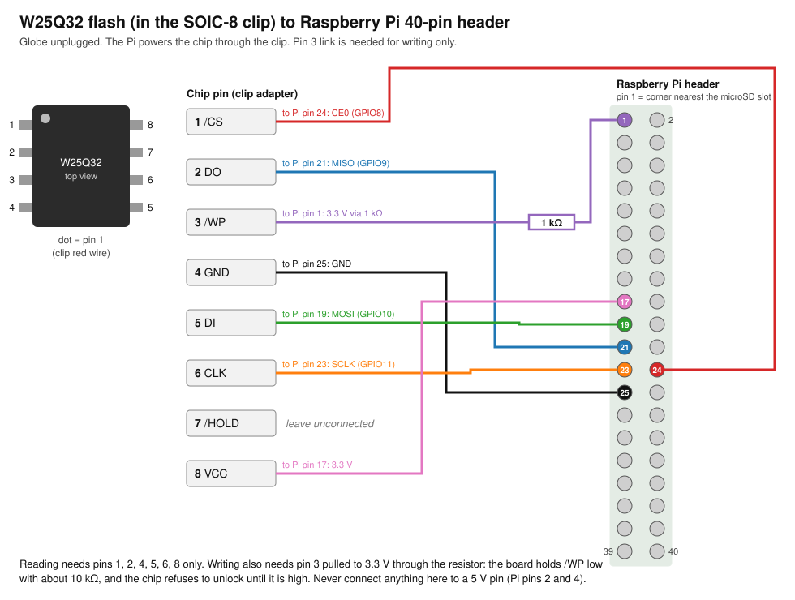
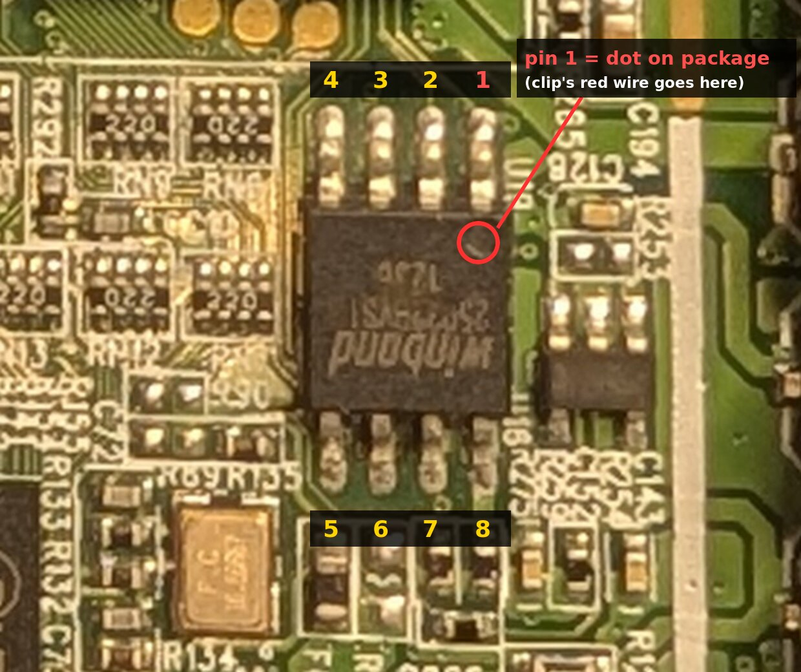

# 04 Flashing with a Raspberry Pi

The Pi's GPIO is 3.3 V, the same as the flash chip, and `flashrom` runs on the
Pi itself. A SOIC-8 clip reaches the chip in place: nothing is desoldered.

## Wiring



| Chip pin | Signal | Pi physical pin | Notes |
|---|---|---|---|
| 1 | /CS | 24 (CE0, GPIO8) | |
| 2 | DO | 21 (MISO, GPIO9) | |
| 3 | /WP | 1 (3.3 V) **through 1 kΩ** | for writing only; leave open for reading |
| 4 | GND | 25 (GND) | |
| 5 | DI | 19 (MOSI, GPIO10) | |
| 6 | CLK | 23 (SCLK, GPIO11) | |
| 7 | /HOLD | not connected | |
| 8 | VCC | 17 (3.3 V) | |

```
 Flash chip (in the clip)                         Raspberry Pi header
 pin 1  /CS   ----------------------------------  pin 24
 pin 2  DO    ----------------------------------  pin 21
 pin 3  /WP   -------[ 1 kΩ ]-------------------  pin 1   (3.3 V)   writing only
 pin 4  GND   ----------------------------------  pin 25
 pin 5  DI    ----------------------------------  pin 19
 pin 6  CLK   ----------------------------------  pin 23
 pin 7  /HOLD     (not connected)
 pin 8  VCC   ----------------------------------  pin 17  (3.3 V)
```

- Pi pin 1 is the corner pin of the inner row, nearest the microSD slot.
- Keep the leads short (10 cm jumpers are fine).
- Never use Pi pins 2 or 4: they are 5 V.
- The clip's pin 1 lead (usually red) goes to the dot on the chip.
  
- The globe is **unplugged** for all of this. The Pi powers the chip, and part
  of the board with it, through the clip.

### Why the resistor

The board pulls the chip's write-protect pin low (about 10 kΩ to ground), and
the chip's status register is locked while that pin is low. Reads work.
Writes fail with:

```
Failed to unlock flash status reg with wp support.
...
Verifying flash... FAILED at 0x...! Expected=0x.., Found=0xff
```

and nothing is written. Pulling pin 3 to 3.3 V through 1 kΩ overrides the
pull-down (it measured 2.99 V at the chip) and writing then works. Use a
resistor, not a direct wire. Check with a meter first: the chip side of the
resistor should read about 2.6 V or more. If it stays near 0 V on your unit,
something is driving the pin and you should stop.

## Pi setup (once)

1. Raspberry Pi OS Lite on a spare microSD card, SSH enabled.
2. On the Pi:
   ```
   sudo raspi-config nonint do_spi 0
   sudo apt update && sudo apt install -y flashrom python3
   sudo reboot
   ```
3. With nothing connected, this should report that no chip was found, with no
   error about the device file:
   ```
   sudo flashrom -p linux_spi:dev=/dev/spidev0.0,spispeed=2000
   ```
4. Copy the scripts in `tools/pi/` to the Pi and make them executable.

## Dumping

1. Globe unplugged for a minute. Clip on, squarely on all eight legs.
2. Probe:
   ```
   sudo flashrom -p linux_spi:dev=/dev/spidev0.0,spispeed=2000
   ```
   Expected: `Found Winbond flash chip "W25Q32BV/W25Q32CV/W25Q32DV" (4096 kB, SPI)`.
   If not, reseat the clip, then try `spispeed=1000`.
3. Take three reads and compare:
   ```
   ./dump3.sh pristine
   ```
   It prints three SHA-256 hashes and PASS only if all three match. Repeat
   until it passes.
4. Copy the files to the PC (`dumps/`) and to at least one other place.

**Reads through a clip are not reliable one at a time.** On the unit tested,
occasional reads came back with a burst of several thousand wrong bytes, at
2000 kHz and at 1000 kHz, while the chip contents were fine. Never trust a
single read; every script here requires reads that agree.

## Test that writing works, without touching the firmware

`scratchtest.sh` writes a pattern into the region 0x3a0000–0x3bffff, which is
erased and unused on this firmware, reads it back, and erases it again.

```
./scratchtest.sh
```

- Without the pin 3 resistor it ends with `NO WRITE HAPPENED` (the chip
  refused). That is the expected result if you want to see the protection for
  yourself.
- With the resistor it should end with `PASS`. If the final comparison fails
  but flashrom printed `VERIFIED`, suspect a read glitch: read again and compare.

## Writing

Build the images on the PC ([03](03-patches.md)), copy them and your pristine
dump to the Pi, then:

```
./writeapp.sh ~/images/pristine_1.bin            # rehearsal: changes nothing
./writeapp.sh ~/images/test0_repack_only.bin     # then test the globe
./writeapp.sh ~/images/test1_poweron.bin         # then test the globe
./writeapp.sh ~/images/test2_poweron_hdmi.bin    # then test the globe
```

`writeapp.sh`:

- writes only the application region, 0x020000–0x0dffff. The bootloader, the
  data after the application and the settings sectors keep whatever is on the chip;
- checks the image's size, header and CRC before writing;
- first reads the chip until two reads agree and keeps that as a backup;
- runs at 1000 kHz;
- after writing, needs two independent read-backs that match the expected
  contents, and writes again (up to three times) if it does not get them;
- asks you to type YES before it writes.

Remove the clip and the resistor link before powering the globe.

Test in this order and stop at the first surprise:

| Image | Expected |
|---|---|
| `test0_repack_only` | exactly stock behaviour |
| `test1_poweron` | power applied: starts without the remote, USB source page |
| `test2_poweron_hdmi` | power applied: live HDMI, no remote |

## Restoring

Clip and resistor on, then:

```
./writeapp.sh ~/images/pristine_1.bin
```

This puts the factory application back. Your settings are not affected either
way, because the settings sectors are never written by this script.

## If something goes wrong

- **FAIL from `writeapp.sh`:** do not power the globe. Reseat the clip and run
  it again with the same image, or with the pristine image.
- **Globe does not reach standby or start after a PASS:** clip back on and
  restore the pristine application.
- **flashrom cannot find the chip:** clip seating, almost always.
