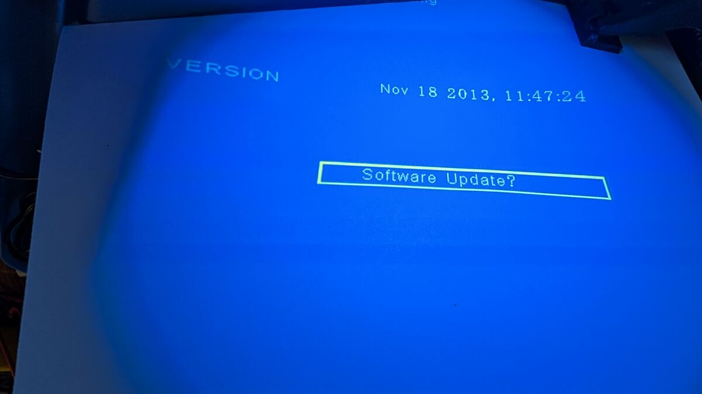
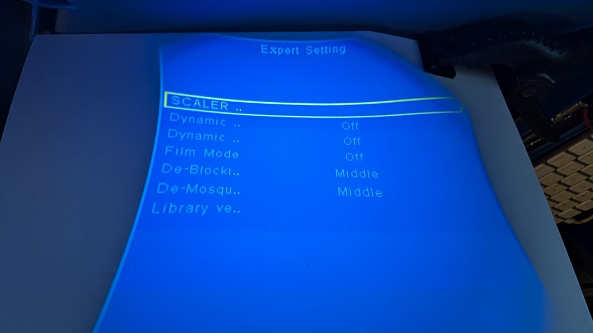
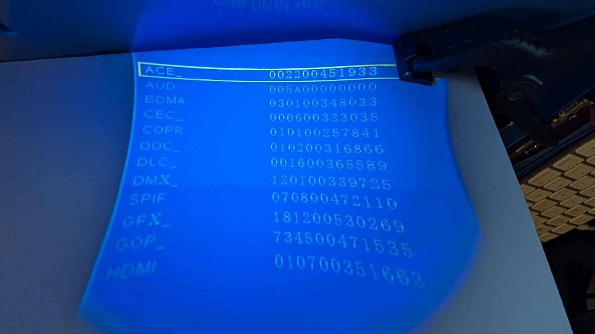

# 05 Hidden menus and IR codes

## Key sequences

Both are entered on the **source page** (the page with the USB and HDMI icons
that appears after power-on with stock firmware; on patched firmware press
Back to reach it).

| Sequence | Needs | Opens |
|---|---|---|
| **Up, Down, Left, Right** | stock remote | "Software Update?" page, with the build date |
| digits **2 5 8 0** | IR codes not on the stock remote | the same page |
| digits **2 5 8 8** | IR codes not on the stock remote | "Expert Setting" page |

The arrow sequence and the Expert Setting page were both seen on hardware (the latter with a
Flipper Zero). Which digit sequence opens which page is taken from the code.

Any other key resets the sequence. The stock remote's 1 to 4 buttons are not
digit keys as far as the firmware is concerned, so the digit sequences need a
programmable remote such as a Flipper Zero (`flipper/WorldEye.ir`, buttons
`D0` to `D9`).

The Software Update page is the entry to the USB updater described in
[06](06-usb-updater.md). Do not confirm it with a USB stick inserted unless
you mean to update.

Expert Setting lists De-Mosquito, De-Blocking, Film Mode, two Dynamic items,
Scaler and Library versions. The last one shows the driver library versions:

In these pages, move with Up and Down. Left, Right, OK, Plus and Minus may
change the highlighted value immediately.

The factory-menu code also contains a power-on-mode setting, but the start-up
code overwrites that value on every boot ([03](03-patches.md)), so no menu can
give power-on-to-HDMI on stock firmware.

## IR codes

Protocol: NEC extended. Address **0x6380** (sent as `80 63`). Command byte
followed by its inverse.

### Stock remote

| Button | Command | Button | Command |
|---|---|---|---|
| Power | 0x00 | Home | 0x01 |
| Up | 0x03 | Down | 0x18 |
| Left | 0x42 | Right | 0x5D |
| OK | 0x5E | Back | 0x1B |
| Plus | 0x40 | Minus | 0x41 |
| Mute | 0x13 | Clear | 0x1A |
| 1 | 0x02 | 2 | 0x07 |
| 3 | 0x05 | 4 | 0x06 |
| Play/Pause | 0x16 | | |

### Digit keys accepted by the firmware (not on the stock remote)

Read from the firmware's IR decode routine (RAM 0x257a88). The same routine
decodes all 17 stock keys correctly, and the digit keys worked on hardware to
open a hidden page.

| Digit | Command | Digit | Command |
|---|---|---|---|
| 0 | 0xD1 | 5 | 0x0C |
| 1 | 0xAD | 6 | 0xB2 |
| 2 | 0x1C | 7 | 0xB3 |
| 3 | 0xAF | 8 | 0x0D |
| 4 | 0xB0 | 9 | 0xB5 |

The decode routine accepts many more command bytes (0xA1 to 0xFD) inherited
from the MStar TV code base; most map to TV functions that this product does
not have. The meaning of an arrow key depends on the screen: on the source
page Up, Down, Left and Right are delivered as four distinct internal keys,
which is what the first sequence above relies on.
